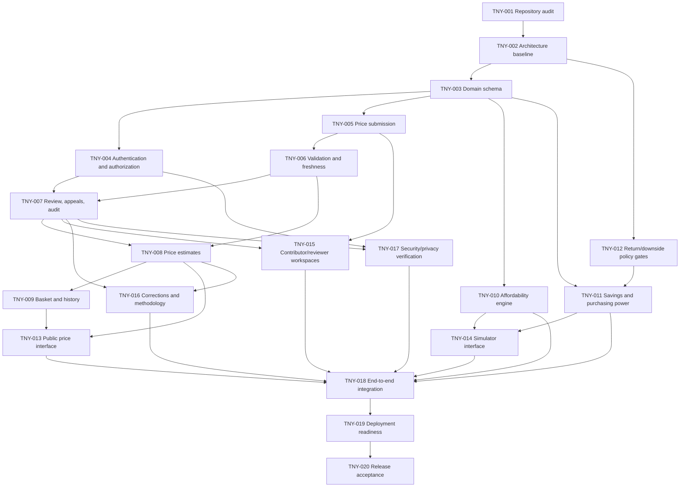

# The New Youth — Implementation Ticket Graph

- **Specification:** [Implementation Specification v1](../specs/implementation-spec-v1.md)
- **Tickets:** TNY-001–TNY-020
- **Initial status:** Proposed / not started
- **Tracking:** Version-controlled Markdown until another tracker is explicitly adopted.

These tickets form a dependency graph, not a sequential checklist. A ticket is ready when all blocking dependencies are complete and repository evidence supports starting it. “Done” requires acceptance evidence, not just code changes.

## Status vocabulary
- **Proposed:** Defined, not started.
- **Ready:** Dependencies complete.
- **In progress:** Work started.
- **Blocked:** Policy, dependency, environment, or external action prevents safe completion.
- **In review:** Implementation awaits verification.
- **Done:** Acceptance criteria and evidence recorded.
- **Deferred:** Explicitly excluded from this release with rationale.

## Dependency graph

## Ticket index

| ID | Ticket | Dependencies |
|---|---|---|
| TNY-001 | Repository and implementation audit | — |
| TNY-002 | Architecture and technical baseline | TNY-001 |
| TNY-003 | Domain schema and migrations | TNY-002 |
| TNY-004 | Authentication and authorization | TNY-003 |
| TNY-005 | Price submission workflow | TNY-003 |
| TNY-006 | Validation and freshness rules | TNY-005 |
| TNY-007 | Review, appeals, and audit history | TNY-004, TNY-006 |
| TNY-008 | Approved price estimates | TNY-006, TNY-007 |
| TNY-009 | Standard basket and historical comparisons | TNY-008 |
| TNY-010 | Household affordability engine | TNY-003 |
| TNY-011 | Savings and purchasing-power engine | TNY-003, TNY-012 |
| TNY-012 | Return and downside policy gates | TNY-002 |
| TNY-013 | Public price evidence interface | TNY-008, TNY-009 |
| TNY-014 | Affordability and savings interface | TNY-010, TNY-011 |
| TNY-015 | Contributor and reviewer workspaces | TNY-005, TNY-007 |
| TNY-016 | Corrections and methodology history | TNY-007, TNY-008 |
| TNY-017 | Security and privacy verification | TNY-004, TNY-007 |
| TNY-018 | End-to-end integration testing | TNY-010, TNY-011, TNY-013–TNY-017 |
| TNY-019 | Deployment and operational readiness | TNY-018 |
| TNY-020 | Release acceptance and documentation | TNY-019 |

## Completion evidence

Each ticket must record changed files/behavior, acceptance criteria and exceptions, tests/checks and actual results, relevant policy/architecture decisions, and remaining risks/blockers. Do not assume GitHub Issues, GitLab, or another tracker. If a tracker is later approved, preserve stable IDs and dependencies when importing.
